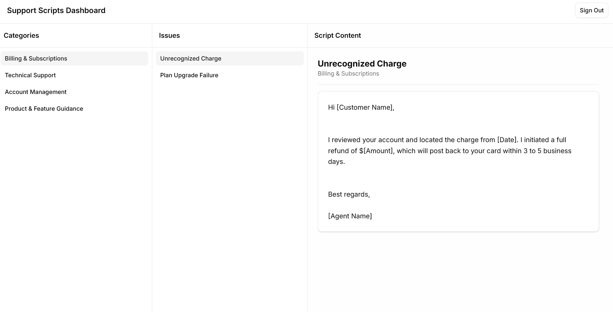
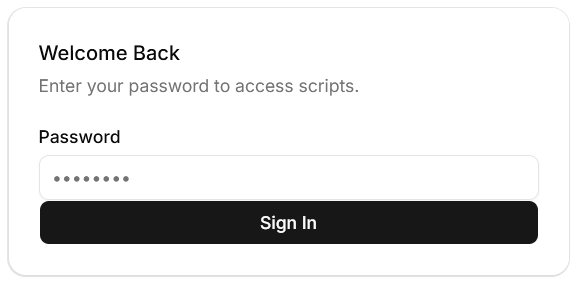
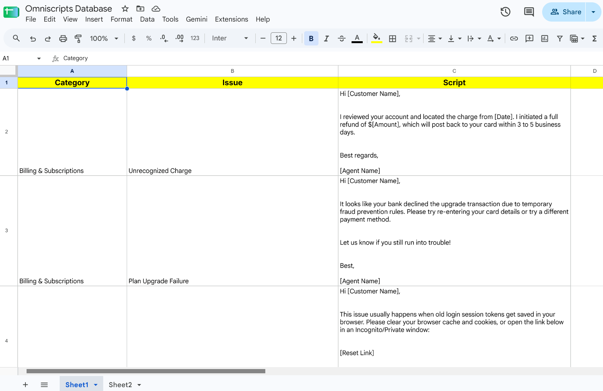

# Omniscripts

Support script dashboard. Pick a category, pick an issue, read the same script. Manage via Google Sheets.

<p align="center">
  
  <br><em>Main dashboard</em>
</p>

<p align="center">
  
  <br><em>Authentication gateway</em>
</p>

<p align="center">
  
  <br><em>Google Sheets</em>
</p>

## Tech stack

- React, Vite, TypeScript, Tailwind, shadcn/ui
- ASP.NET Core minimal API (.NET 10)
- Google Sheets as headless CMS
- Cloudflare Pages functions for the proxy function

## Who is it for?

I made this as a quick prototype for an internal tooling for my mom's work.

Anyone who needs to access a unified response script can benefit from this minimal setup and straightforward workflow.

## Details

Three panes: categories, issues, script content. Scripts live in a Google Sheet with three columns: `Category`, `Issue`, `Script`. Editing the sheet updates the app. The API reads the sheet via the Google Sheets API and serves it to the frontend.

Auth is a single shared password. The server exchanges it for a JWT (12h expiry), stored in localStorage. Update the password in the Google Sheets.

The SPA and API are on different hosts, so a Cloudflare Pages function at `functions/api/_middleware.ts` proxies `/api/*` to the backend to avoid CORS issues.

You can serve the web app directly from the same domain by using the Static Files middleware and building the React app and bundling it. But I prefer doing it this way to utilize CDNs.

## Layout

```
omniscripts/
├── src/
│   ├── server/                  # .NET 10 Minimal API backend
│   │   ├── Dtos/                # Data Transfer Objects (login, scripts)
│   │   ├── Models/              # Domain models
│   │   ├── Services/            # GoogleSheetsService integration logic
│   │   └── Program.cs           # API entry point & endpoint routing
│   │
│   └── web/                     # React + Vite frontend
│       ├── functions/           # Cloudflare Pages API proxy middleware
│       └── src/
│           ├── components/      # shadcn/ui primitives & dashboard views
│           ├── lib/             # API client utilities
│           └── App.tsx          # Root & auth state management
```

## Configuration & Environment Variables

The backend requires the following. Use `appsettings.json`, environment variables, user-secrets, and common sense:

| Key                               | Description                                                                   |
| :-------------------------------- | :---------------------------------------------------------------------------- |
| `Jwt:Key`                         | Secret key used to sign and validate JWT tokens.                              |
| `GoogleSheets:SpreadsheetId`      | The target Google Sheet ID used for auth and script storage.                  |
| `GoogleSheets:ServiceAccountJson` | Base64-encoded JSON string containing the Google service account credentials. |
| `GoogleSheets:ApplicationName`    | Name passed to the Google API client, used for logging.                       |
| `GoogleSheets:SheetRange`         | Optional range for script data (defaults to `Sheet1!A2:C`).                   |

For the frontend, configure the following environment variable:

| Key               | Description                                     |
| :---------------- | :---------------------------------------------- |
| `BACKEND_API_URL` | The base URL of your deployed .NET backend API. |

## Running as your own

You'll need Node, the .NET SDK, and a GCP service account. I used `pnpm` but it's totally up to personal preference.

Set up your Google Sheet with a structure shaped like this:

|     | 1                       | 2                   | 3                       |
| --- | ----------------------- | ------------------- | ----------------------- |
| A   | Category                | Issue               | Script                  |
| B   | Billing & Subscriptions | Unrecognized Charge | Hi [Customer Name], ... |

And put the password in tab `Sheet2`, in cell `B2`.

## Try in dev

```bash
# API
cd src/server
dotnet run

# Frontend
cd src/web
pnpm install
pnpm dev
```

# LICENSE

Available under [MIT License](LICENSE).
